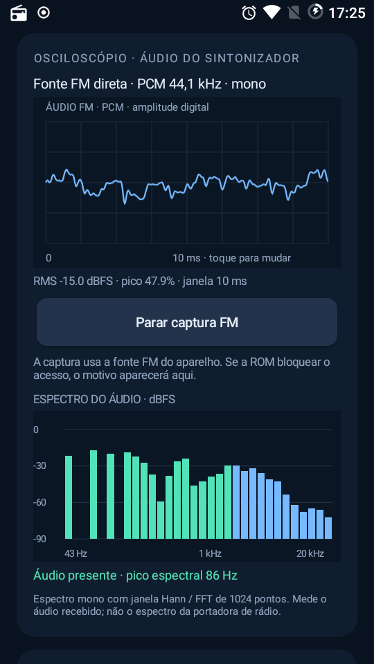

# FM Lab

An experimental **hardware FM radio companion and reception analyzer** for the **Samsung Galaxy S4 Mini GT-I9195 running LineageOS 14.1 / Android 7.1.2**, without root.

FM Lab controls the built-in tuner through the native radio service and displays the reception data exposed by the firmware. It receives over-the-air FM; it does not stream stations over the internet.

**Compatibility is currently verified only on the device and ROM above. The APK interface is currently in Brazilian Portuguese.** Having an FM chip does not automatically make another phone compatible.

[Download experimental APKs](https://github.com/Adoregabriel2005/fm-lab/releases) · [Changelog](CHANGELOG.md)

## Multi-device effort (0.8)

We are working toward stock-ROM and multi-device support by reusing accessible native FM implementations. Version 0.8 adds a dedicated CAF adapter, conservative adapter selection, native-radio discovery/launch, and a copyable compatibility report. Android 5.0 / API 21 is now the declared installation minimum; legacy-device runtime validation is still pending. The only physically verified tuner target remains the S4 Mini configuration above.

**This is not universal FM support.** Motorola, MediaTek, Samsung stock, Sony, Xiaomi, and Huawei packages are discovery candidates, not working tuner adapters. Private or privileged native interfaces may prevent integration from an ordinary APK.

See the [device support matrix, requirements, and implementation roadmap](docs/DEVICE_SUPPORT.md). To help with a port, [open a Device support issue](https://github.com/Adoregabriel2005/fm-lab/issues/new/choose) with the reviewed compatibility report and whether the native radio works.

## Help bring FM Lab to more devices

**Own a phone with working native FM? You can help, even without coding.** We need device/ROM reports, testing on older and newer Android versions, and verified native radio interfaces to develop additional adapters.

- [Read the contribution guide](CONTRIBUTING.md) for device reports, testing, protocol research, code, and documentation.
- [Submit a Device support report](https://github.com/Adoregabriel2005/fm-lab/issues/new?template=device-support.md) with your exact model, Android/ROM, native radio version, and observed behavior.
- [Check the support matrix and porting roadmap](docs/DEVICE_SUPPORT.md) to see what is implemented and what is still needed.

Please keep the factory radio installed. Hardware FM support alone does not guarantee that another app can access it. Each model/ROM and capability must be validated separately.

## 1.0 release candidate

**1.0.0-rc1 is a release candidate, not a stable certification.** It keeps the 0.10 stability work and makes version labels, diagnostics, and APK filenames derive from package/manifest metadata. Its signature matches 0.10, so an in-place upgrade is eligible; actual data preservation still needs a device test.

Build, signature, packaging checks, and all 204 automated checks pass. Physical S4 Mini regression and sustained-use testing are still pending. See the [release validation checklist](docs/RELEASE_VALIDATION.md). The candidate does not expand verified tuner compatibility.

## Stability and cleanup (0.10)

- Scanning and ordinary native radio work now share a bounded serial worker. CAF transactions are also synchronized, and queued controls are ignored if a scan started or the bridge changed.
- Connection/scan generations and bridge identity checks reject stale completions. Leaving the screen cancels scanning with attempted restoration; explicitly opening the native radio preserves the separate no-restore policy. Restoration and unmuting remain best effort.
- Audio frame delivery is generation-aware, so callbacks from a stopped capture cannot unlock a new session. Vendor audio stop requests are dispatched off the UI thread, empty reads are bounded, and split stereo frames preserve their trailing sample.
- FFT buffers and the Hann window are reused per capture session; meter coefficients and temporary sums are reused. The RF animation is disabled while paused or in compact mode. No device performance benchmark is claimed.
- CSV writes run off the UI thread. Missing pending export data is reported rather than silently written, and malformed saved favorites/measurement entries are skipped on read.
- Java sources and tests use consistent formatting; named internal operations replace repeated mute/stereo magic numbers.

**204 automated checks passed**, including 53 new lifecycle/workspace/queue checks. Physical-device regression, vendor shutdown behavior, Android file-provider export, and actual CPU/memory impact still require testing. Synchronous vendor Binder calls cannot be forcibly timed out by this implementation; a stalled vendor service remains a limitation.

## What makes FM Lab different (0.9)

The aim is to help you understand and compare actual reception, beyond tuning and station presets:

- **Guided antenna A/B comparison:** capture A for 10 seconds, move the headphone cable, then capture B on the same requested frequency. Compare mean raw SINR and its standard deviation. It rejects insufficient/stale trials and clears the reference on tuning/state resets or leaving the app. This is not a controlled laboratory experiment: changing interference and propagation can affect the result, so repeat it.
- **Audio spectrogram:** eight seconds of 32-band FFT history from 43 Hz to 20 kHz, grouped into 100 ms time buckets. It shows changing audio content, not the RF spectrum or adjacent stations.
- **Freeze waveform/spectrum/spectrogram:** inspect a captured visual while live digital meters and alerts continue. This does not record or pause playback.
- **Continuous digital level meters:** process every PCM block delivered by AudioRecord, independently of drawing/FFT frame delivery. RMS uses a 300 ms exponential mean-square response; sample peaks have a 1-second hold followed by 20 dB/s decay. Exact full-scale PCM samples are counted for the capture session.
- **More faithful oscilloscope rendering:** rising zero trigger with arming hysteresis, per-pixel extrema for dense waveforms, and window RMS/peak calculated from the displayed sample range.

These changes are experimental; the new UI, drawing performance, and end-to-end audio measurements still need physical-device validation.

## Features

- Requested tuning range of **76–108 MHz**, including extended FM, subject to native service and hardware limits.
- Raw RSSI and SINR readings, reception history, and adjustable signal quality colors.
- Target polling rates of 4, 10, or 20 Hz; signal graph targeting 30 FPS. Actual rates depend on the device.
- RDS station name, RadioText, PI, PTY, and ECC when available.
- **Stereo/mono reception status from actual receiver events**, plus automatic stereo and forced mono controls.
- Quick and full band scans, candidate refinement, and ranking by average SINR, stability, and RSSI.
- Oscilloscope using **audio captured directly from the FM source**, with no microphone fallback.
- Mono audio spectrum, RMS, peak level, low audio detection, and digital peak warnings.
- Named 10-second reception measurements to compare rooms and antenna positions.
- Favorites, continuous metric logging, and CSV export through Android's file picker.
- Fixed bottom navigation, persistent compact mode, mute, and the last 12 requested frequencies.
- Timestamped history of the last 30 RadioText changes during the session, and reception report sharing.



*Screenshot from version 0.4, showing the direct FM audio analysis. It does not depict the updated 0.7 navigation.*

## Installation and first use

1. Download the APK from [Releases](https://github.com/Adoregabriel2005/fm-lab/releases). These are experimental builds.
2. Keep the native `com.caf.fmradio` app installed. The current integration checks for versionCode `25`, versionName `7.1.2`.
3. Connect wired headphones, which serve as the phone's FM antenna.
4. Turn on FM in the native radio app, then open FM Lab. The native app can remain in the background.
5. Tune from FM Lab so measurements can be associated with the requested frequency.
6. For audio analysis, tap **Ativar captura de áudio FM** and grant the audio permission requested by Android.

FM Lab uses its own package, `br.local.fmlab`, and does not replace the native app. Both share the same tuner: changing frequency or turning FM off affects both apps.

## Finding the strongest received stations

Open **Testes** (Tests), find **Busca e comparação de emissoras**, and tap **Varrer FM** (Scan FM).

- Choose wideband **76–108 MHz**, conventional **87.5–108 MHz**, or extended FM only **76.1–87.3 MHz**.
- **Rápida** (Quick): 0.2 MHz steps aligned to odd decimal channels; 76.1–107.9 MHz for the wide band.
- **Completa** (Full): 0.1 MHz steps including the selected band's endpoints; 76.0–108.0 MHz for the wide band.
- Keep the phone and headphone cable still. The screen stays on during scanning.
- Scanning temporarily mutes audio and enables automatic stereo. It takes three initial samples per frequency, then revisits up to 12 candidates with more settling time and eight samples each.
- Results are ranked by descending average SINR, then lower SINR variation, then higher RSSI. Tap a result to request tuning.
- On completion, the app attempts to restore the frequency requested before scanning and undo the mute it applied. **Cancelar** stops the scan; incomplete results are labeled as partial.

These are reception candidates, not a guaranteed list of every local broadcaster. RDS may not arrive during a channel's dwell time. Antenna position and interference affect the ranking. Initial candidate selection uses average SINR of at least 1; this is not a universal calibration.

Band selection requests frequencies from the native service. It does not reconfigure or unlock the firmware, and rejected tuning commands are not counted as received stations.

## Everyday controls

The fixed bottom navigation links to **Rádio** (Radio), **Áudio** (Audio), **Testes** (Tests), and **Dados** (Data).

- **Modo compacto** in the panel settings hides connection controls and the RF graph for the small display. Acquisition continues at the selected rate; turn compact mode off to restore the full panel.
- **Mudo / Ouvir** toggles mute using the native service state.
- **Recentes** lists up to 12 distinct requested frequencies whose tuning commands were accepted. These entries persist across sessions; acceptance is not confirmation of the chip's current frequency.
- **Texto RDS** shows up to 30 RadioText changes with timestamps. This history is temporary and can be cleared.
- **Compartilhar** opens Android's share chooser with station information and recent reception metrics. Stale metrics are omitted. Frequency is explicitly labeled as requested.

## Comparing reception locations

In **Testes → Medir local · 10 s**, name a location, wait for collection to finish, then repeat elsewhere. **Comparar locais** groups measurements by frequency and sorts by average SINR. Keep the same phone, frequency, and headphone cable arrangement to isolate the change you want to compare.

Favorites and up to 50 measurements are stored locally. Continuous logging holds up to 12,000 readings in memory; export before closing or updating the app. Leaving the screen, turning FM off, or changing tuning interrupts collection. CSV uses semicolons and decimal points. CSV formatting is covered by tests; saving through the device's file picker has not yet been verified end to end.

## Accuracy and limitations

- RF values are **raw driver readings**, without calibrated dBm conversion. They do not estimate transmitter wattage or distance.
- Signal colors use adjustable thresholds and do not guarantee clean audio.
- The service does not expose a current-frequency query. The UI shows requested frequencies or accepted restoration commands.
- Stereo status comes from the native service's `onAudioUpdate` callback. Enabling automatic stereo does not prove stereo decoding succeeded. Mono reception does not prove the station broadcasts only in mono.
- RF stereo status is separate from the mono PCM used for audio analysis; it is not inferred from audio channel differences.
- Audio uses vendor source ID `1998`, verified on the target device. There is no microphone or general output-mix fallback.
- Audio analysis uses 44.1 kHz capture, a 1,024-point Hann-window FFT, and DC removal. The spectrum represents **audio**, not the RF carrier. RMS and dBFS are digital levels, not volts or field strength.
- The receiver must still be initialized from the native UI to avoid an observed Looper failure when powering on through a remote Binder call.
- The native protocol has only one callback slot. FM Lab registers while foregrounded; the native app registers again when opened. FM Lab does not clear the other app's observer on exit. Its observer holds a weak Activity reference. This ROM-specific integration can affect native UI updates.
- The original APK, vendor libraries, firmware, decompiled vendor sources, and private signing keys are not distributed here.

### Signed SINR interpretation

Device testing found weak channels returning unsigned-promoted 8-bit values, such as `254`. FM Lab maps `128–255` to `−128…−1` **before** averaging, coloring, or ranking. Already-signed values are preserved; values outside the supported range are discarded. RSSI remains raw. This is representation correction, not unit calibration.

Target implementation references: [Iris structures and limits](https://github.com/LineageOS/android_kernel_samsung_msm8930-common/blob/cm-14.1/include/media/radio-iris.h) and [driver SINR handling](https://github.com/LineageOS/android_kernel_samsung_msm8930-common/blob/cm-14.1/drivers/media/radio/radio-iris.c). Regression tests cover negative SINR ranking.

## Extended FM and device compatibility

The app accepts tuning requests from 76.0 to 108.0 MHz. Actual acceptance depends on hardware and the native radio configuration. If frequencies below 87.5 MHz are rejected, check the native app's region/band options. Selecting a Japanese region may also lower the upper limit, so it does not necessarily enable the full 76–108 MHz range. FM Lab does not modify the system app's private preferences or unlock driver bands.

| Device / environment | Status |
| --- | --- |
| GT-I9195, LineageOS 14.1, Android 7.1.2, analyzed CAF service | Tested target |
| Another device with the same CAF service, protocol, and permissions | Possible candidate; unverified |
| Different service, chipset, or firmware | Requires a compatible backend and device testing |
| No FM tuner accessible to Android | The app cannot provide that hardware |

Audio, RDS, stereo events, extended tuning, and RF metrics are separate capabilities. For compatibility reports, include the exact model, ROM, Android version, native radio package/version, and observed error. There is no claim of universal Android or Motorola support.

## Build on Windows

Toolchain used: JDK 25.0.3, Android SDK Platform 34, Build Tools 36.0.0. Java targets Java 8 and DEX targets API 21. No Gradle or external library dependencies are required.

```powershell
.\build.ps1 -Sdk 'C:\Android\Sdk' -Java 'C:\Program Files\Android\Android Studio\jbr'
```

Output: `dist/FM-Lab-1.0.0-rc1.apk`. Intermediate files and the local development key go in Git-ignored `.build/`. A fresh clone generates its own test key; it cannot update APKs signed with the distributed build's key. To use an existing local test key, pass `-KeyStore 'C:\path\test-key.p12'` with the test signing configuration expected by the script. Never publish private keys.

## Tests and validation

```powershell
.\test.ps1 -Sdk 'C:\Android\Sdk' -Java 'C:\Program Files\Android\Android Studio\jbr'
```

The original 97 automated checks cover known-tone FFT, amplitude, DC, silence, missing samples, measurement statistics, CSV formatting, signal thresholds, polling policy, scan ranking, signed SINR, and band limits/alignment. JVM tests do not replace physical tuner testing or UI validation.

- **0.5:** 83 automated checks and a real GT-I9195 scan. Refinement returned RDS names and stereo/mono events. Testing exposed and corrected unsigned-promoted SINR. Local station measurements are not distributed in the repository.
- **0.6:** 97 checks. The target accepted 76.1 MHz and a driver event confirmed `Tuned Frequency: 76100`; useful station reception was not confirmed at that frequency. Previous tuning was restored. This was not a complete extended-band survey.
- **0.7:** APK built, signature verified, and the same 97 checks passed. The new layout and controls still require physical-device validation; there are no new automated UI tests.

Version 0.8 adds eight backend selection checks (105 total). Its adapter refactor, discovery UI, and API 21/22 runtime behavior still require physical-device validation.

### Reading the new meters

Levels use **dBFS**, referenced to signed 16-bit PCM full scale. A full-scale sine has approximately −3.01 dBFS RMS; a half-scale sine has approximately −9.03 dBFS RMS. The 300 ms display has startup/settling behavior and is not a calibrated analog VU meter or a claim of standards compliance. Peak means **sample peak**, not reconstructed intersample true peak. Full-scale counts are digital-limit observations, not proof of where analog distortion occurred.

When stereo PCM fallback is available, meters read L/R before mono downmix so opposite-phase channels do not cancel in the channel meters. The waveform, FFT, and spectrogram still show the mono signal. Native stereo reception events remain a separate RF measurement. The mono capture path does not create independent L/R channels.

The oscilloscope uses nominal 44.1 kHz PCM with a fixed full-scale vertical range and 5/10/20 ms windows. It is a framed display, not a lossless waveform recording. Graph freezing does not freeze meters. Gain, routing, firmware processing, or resampling can influence captured digital levels; these readings are not calibrated input voltage, FM deviation, or transmitter modulation.

Version 0.9 adds 22 A/B trial checks and 24 continuous metering/trigger checks, bringing the total to **151**. Tests include known sine RMS, the analytical 300 ms response, full-scale counts, UI-skipped block peaks, peak hold/decay, and anti-phase stereo channel preservation. These mathematical tests do not validate the vendor capture path or screen behavior on a physical phone.

## Architecture

- `RadioBridge` / `CafRadioBackend`: internal operation contract and analyzed CAF Binder adapter.
- `BackendRegistry` / `DeviceSupport`: conservative profile selection, native radio discovery, and compatibility reports.
- `RadioEvents`: receiver event observer.
- `BandScanner`: sequential scanning and candidate ranking.
- `BandPlan`: tuning limits and scan channel alignment.
- `AudioScope` / `AudioAnalysis`: direct FM capture and PCM analysis.
- `LabFeatures` / `Measurement`: favorites, named measurements, logging, and CSV.
- `ReceptionTrial`: validated 10-second A/B raw SINR trials.
- `AudioMeter` / `LevelMeterView`: continuous digital metering and live level display.
- `MainActivity`, `ScopeTrigger`, `ScopeView`, `SpectrumView`, `SpectrogramView`, `SignalPlot`: interface and graphs.

## License

No redistribution license has been selected yet. Public source availability does not grant rights to system or firmware components.
