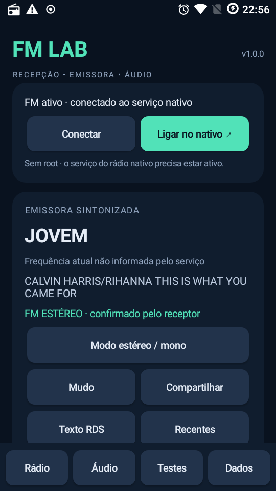
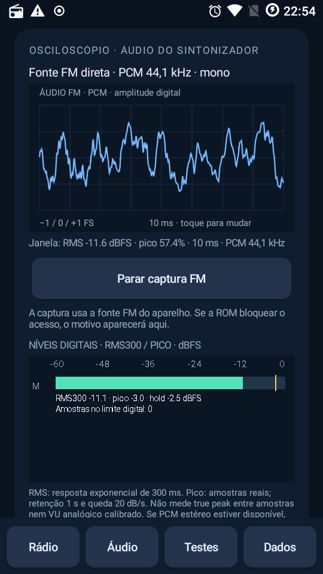
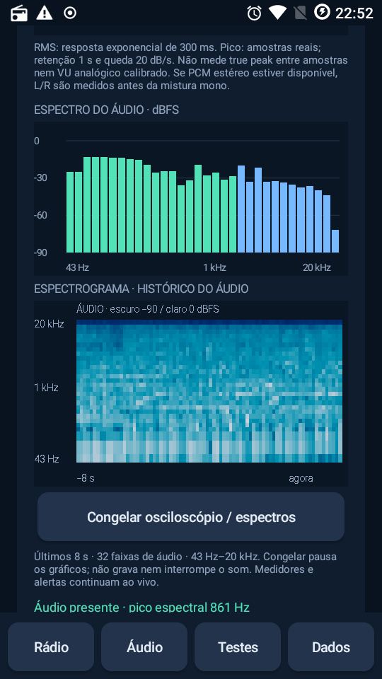
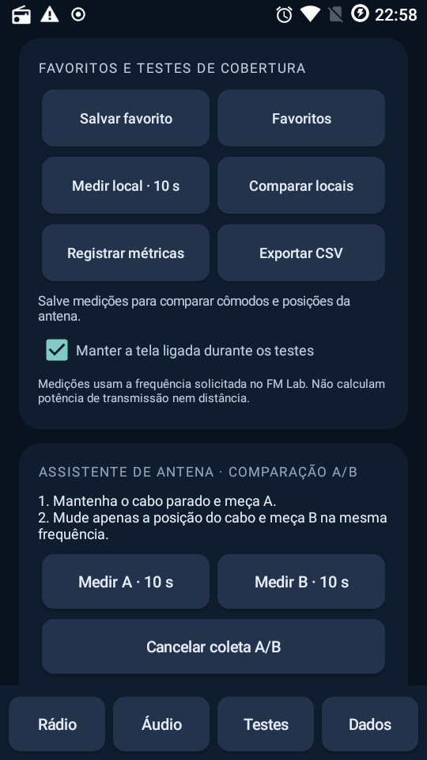
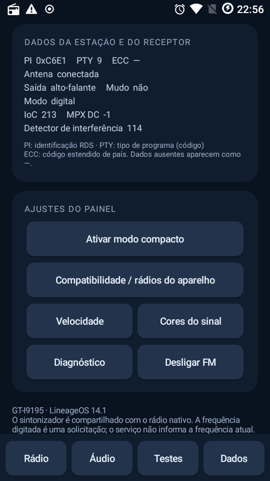

# Illustrated guide

These are real S4 Mini GT-I9195 captures from the 1.0 release preparation. The interface is currently in Brazilian Portuguese. Values are examples from one moment, not a coverage map, a benchmark, or measurements that can be transferred to another phone.

## 1. Connect to native FM

Keep the original radio installed and connect wired headphones. Use **Ligar no nativo** (open native radio) to initialize FM, then return to FM Lab. **Conectar** reconnects to the service. RDS station name and RadioText appear when decoded. **Modo estéreo / mono** selects automatic stereo or forced mono; the received stereo indicator depends on a real tuner event. An unknown indication is not proof of mono reception.

The requested frequency is not a readback of the tuner frequency. This CAF service does not expose current-frequency readback; the app explicitly identifies this limitation.

## 2. Inspect actual received audio

Open **Áudio**, tap **Ativar captura de áudio FM**, and grant audio permission. The source label shows direct FM PCM and the captured format. There is no microphone fallback. Tap the oscilloscope to change its time window. Dense waveforms preserve sample extrema and use a rising zero-crossing trigger.

The waveform summary describes the displayed window. The meter uses a separate continuous 300 ms exponential RMS response, sample peaks, a one-second peak hold and 20 dB/s decay. These numbers can differ because their time windows differ. Levels are digital dBFS, not volts, transmitter watts, analog calibrated VU or intersample true peak. Captured mono does not prove the station is transmitting mono.

## 3. Inspect the spectrum over time

Scroll within **Áudio** to see a 1,024-point Hann-window FFT and eight seconds of audio history in 100 ms time buckets. Darker cells have lower digital levels. **Congelar osciloscópio / espectros** freezes the visual history; **Retomar** resumes it. Playback and live meters continue.

This is the audio spectrum, not an RF spectrum analyzer. At 44.1 kHz the FFT spacing is about 43 Hz; narrow display bands can share the same resolved bin. There is no extra low-frequency resolving power from drawing more bars.

## 4. Compare antenna positions and save results

Open **Testes**. **Medir local** saves a named ten-second measurement; **Registrar métricas** starts a session log and **Exportar CSV** opens Android's file picker. Export the in-memory log before closing the app. Saved named measurements persist separately.

For A/B, keep the frequency fixed: measure A, move only the antenna cable, then measure B. The comparison uses raw SINR mean and variation. It does not estimate distance or transmitter power. Changing tuning, leaving the app, or losing state invalidates the comparison reference.

Farther down, **Varrer FM** offers quick/full scans and conventional/extended band plans. A scan temporarily retunes and mutes the shared receiver, ranks valid samples, and attempts to restore the requested tuning and audio state. Results describe the reception at the time of the scan; they do not establish the best station everywhere.

## 5. Read receiver details and adjust the panel

Open **Dados** for PI, PTY, ECC, antenna/output state and other values exposed by the driver. Missing values stay unavailable. Raw driver quantities are not automatically calibrated physical units.

Use **Ativar modo compacto** to simplify the panel, **Velocidade** for the polling target and **Cores do sinal** for quality thresholds. Actual update rate depends on firmware. **Compatibilidade / rádios do aparelho** prepares a report for contributors; review it before sharing. **Diagnóstico** copies the current diagnostic text locally.

## Launcher name

The installed application and launcher activity are explicitly named **FM Lab** and the build checks both packaged labels. During validation the S4's application drawer showed the correct name. If an old home-screen shortcut still carries an earlier corrupted title, remove only that shortcut and add FM Lab again from the drawer. Do not uninstall the app or clear launcher data merely to rename a shortcut.

See [release validation](RELEASE_VALIDATION.md) for the exact tested device, candidate coverage and remaining cases.
